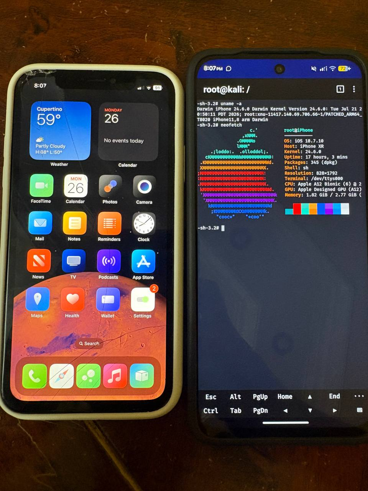

# XRa1n

Tethered jailbreak for **iPhone XR (iPhone11,8 / n841ap)** on **iOS 18.7.10
(22H374)**. The phone must be booted through the host after a reboot.

<p align="center">
  
</p>

## Status

### Working

- Erase restore and tethered iOS boot
- SSH and USB pairing
- Wi-Fi, Bluetooth, and VPN
- Outgoing calls
- Camera, flashlight, and audio
- Photos, Files, and wallpapers
- App Store downloads
- Sileo, APT, and tweaks

### Not working

- Incoming calls
- iCloud services

## Host and files

The usbliter8 exploit requires a compatible **RP2350 board**, such as a
**Raspberry Pi Pico 2** or **Waveshare RP2350 USB-A**, flashed with compatible
usbliter8 firmware. Use it to put the XR into pwned DFU before each tethered
boot stage. **DCSD serial capture is optional**; it requires a separate serial
setup, such as the Pico B4 Ultra used during development.

XRa1n was built and tested on **Kali NetHunter Linux ARM64**. The bundled
Linux/aarch64 host tools came from the RBIS environment used for testing. They
are not binaries for macOS or x86-64 Linux. Another host needs compatible
builds of the tools and shared libraries, followed by validation of the boot
and restore workflow. Liter8 builds its pinned
[`idevicerestore`](https://github.com/Xplo8E/Liter8/blob/main/setup.sh) from
the official [libimobiledevice source](https://github.com/libimobiledevice/idevicerestore/commit/60192e97f87d1bbab5c493684e0a245b0966363f);
it is not a Liter8-specific fork. See [host tools](tools/host/README.md).

Provide your own **stock 22H374 iPhone XR IPSW**. From the repository root,
create `work/cfw/` and extract the IPSW directly into it (not into a nested
directory):

```sh
mkdir -p work/cfw
unzip -q /path/to/iPhone11,8_18.7.10_22H374_Restore.ipsw -d work/cfw
test -f work/cfw/BuildManifest.plist
```

The scripts do not download or extract the IPSW. Place these
[release assets](https://github.com/dr1408/XRa1n/releases)
at the following repository paths:

| File | SHA-256 |
| --- | --- |
| `kernelcache.patched-0x891-full-aks.im4p` | `900fb9e106ef5c9d9a7085add1ca0133071f9a0e41a3969c69af6d49cb5f0cbe` |
| `RestoreRamDisk.patched.im4p` | `6fc6e23cbd5a9955aad9d5e4f4025c2145c9e82719660c8bbf751813935f5f76` |
| `RestoreRamDisk.sshrd.im4p` | `9c858c5ac79ba302626de338e028f4b306d22cc9228eceb2c57d2c8d33a5ff53` |
| `dist/install-bundle-iphone11.8-22H374.tar.gz` | `39f0c2c3cb9bd529176669b35d979b21e63ebf0276814def24c8b4cebc4cfbeb` |

Check the bundled host tools before using the device:

```sh
python3 host_tools.py --check
```

## Restore, install, boot

Run from the repository root. Each boot stage starts with the XR in
USBLiter8-pwned DFU. **No serial hardware is needed for the default commands:**

1. **Erase restore:** `python3 -u run_restore.py`
2. **Return to pwned DFU; boot SSHRD:** `python3 -u run_sshrd_boot.py --boot`
3. **Install from SSHRD:** `python3 -u install_sshrd_userland.py --install`
4. **Return to pwned DFU; boot iOS:** `python3 -u run_normal_boot.py --boot`
5. **Finish on normally booted iOS:**

   ```sh
   python3 tools/xra1n-finalize.py --check
   python3 tools/xra1n-finalize.py --apply
   python3 tools/xra1n-finalize.py --check
   ```

If you have DCSD serial capture connected, add `--serial` to the three boot
commands instead:

```sh
python3 -u run_restore.py --serial
python3 -u run_sshrd_boot.py --boot --serial
python3 -u run_normal_boot.py --boot --serial
```

`--serial` adds `serial=3` to the iBoot boot arguments and requires the logger
to open `/dev/ttyACM0`; the default omits `serial=3` and never starts that
logger. Both modes retain the other boot arguments. Serial mode can detect
kernel panics in its log; without it, `bootx` only confirms image transfer, so
confirm the resulting device or SSH state. The no-serial path passed offline
patch and orchestration checks; the recorded hardware boots used serial.
The chosen mode is checked against
the prepared images and restore record: use the same mode for a prepared
restore, or run `python3 run_restore.py --prepare-only [--serial]` to prepare a
different mode from the verified pristine inputs before another restore.

The SSHRD installer generates a host-only SSH private key if one is missing;
retain that key for later normal-boot access. The finalizer does not enable
`lhook`, respring, or restart already-running daemons. To use tweaks and the
App Store/VPN/Files compatibility hooks on each normal boot, run the following
as root **on the iPhone** after finalization:

```sh
/var/jb/usr/bin/lhookctl enable
for name in installd installcoordinationd nehelper fileproviderd; do
    killall -9 "$name" 2>/dev/null || true
done
```

`installd` and `installcoordinationd` reload the App Store persona hook;
`nehelper` reloads the VPN approval hook; `fileproviderd` reloads the Files
hook. Launchd respawns them. Respring separately when you want SpringBoard
tweaks to load. This step is manual and must be repeated after a new normal
boot; do not run it from SSHRD. See the detailed
[restore](BOOT_WORKFLOW.md), [SSHRD install](POST_SSHRD_INSTALL.md), and
[normal boot](NORMAL_BOOT.md) guides for checks and stage-specific behavior.

### Optional: NewTerm root shell

NewTerm's bundled login path cannot gain root on XR 22H374 because the Data
volume is mounted `nosuid`, so a stock NewTerm launch opens as `mobile` and
exits before a shell appears. The optional `--newterm-root` finalizer flag
installs a signed `persona-99` spawn adapter over `/var/jb/usr/bin/login` and
a replacement `NewTermLoginHelper` with the correct tty and environment setup.
Both stock originals are preserved as `.liter8-real`. This is opt-in because
it only takes effect at the device owner's explicit request.

After installing **NewTerm** from Sileo (`ws.hbang.Terminal`):

```sh
python3 tools/xra1n-finalize.py --check --newterm-root
python3 tools/xra1n-finalize.py --apply --newterm-root
python3 tools/xra1n-finalize.py --check --newterm-root
```

Re-run `--apply --newterm-root` after any Sileo upgrade of NewTerm so the
helper is restored on top of the fresh package. The `.liter8-real` backups
are preserved across re-applies. Without the flag, the finalizer never
touches `login` or NewTerm.

## Credits

- **[Paradigm Shift](https://web.archive.org/web/20260618141609/https://ps.tc/pages/blog-usbliter8.html):** original usbliter8 SecureROM exploit.
- **wh1te4ever and [usbliter8-fun](https://github.com/wh1te4ever/usbliter8-fun):** early custom-firmware and ramdisk work.
- **0xjohnnydev and [his usbliter8-fun fork](https://github.com/0xjohnnydev/usbliter8-fun):** standard-iPhone-11 port and documented restore/boot work that informed the XR workflow.
- **Xplo8E and [Liter8](https://github.com/Xplo8E/Liter8):** firmware patching and boot workflow, restore/userland work, and the basis for several XR runtime fixes.
- **gru2007 and [Liter8-iPad8](https://github.com/gru2007/Liter8-iPad8):** task-port and Files compatibility research used in the XR port.
- **[Procursus](https://github.com/ProcursusTeam/Procursus):** rootless bootstrap and package repository.
- **[ElleKit](https://github.com/opa334/ElleKit) and [Sileo](https://github.com/Sileo/Sileo):** tweak injection and package manager.
- **[libimobiledevice](https://github.com/libimobiledevice/idevicerestore) and [tihmstar](https://github.com/tihmstar/img4tool):** restore/USB tooling and Image4 tooling.

Thanks to all upstream contributors. Bundled third-party code, tools and
payloads retain their respective licenses; XRa1n's XR-specific changes do
not replace those upstream projects.
